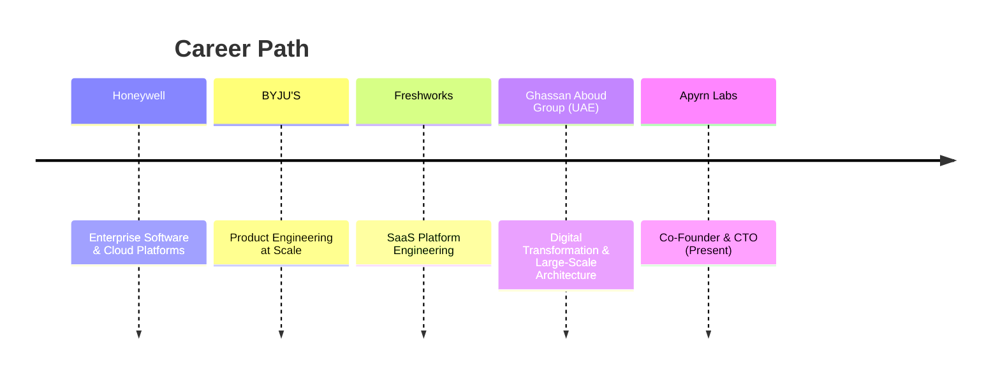

<div align="center">


<a href="https://apyrn.com"></a>

<br/>

<a href="https://apyrn.com"></a>
<a href="https://www.linkedin.com/in/rurajavel"></a>
<a href="mailto:raja@apyrn.com"></a>

<br/>

<sub>
<a href="#about">About</a> •
<a href="#the-apyrn-ecosystem">Apyrn Ecosystem</a> •
<a href="#career-journey">Career</a> •
<a href="#tech-stack">Tech Stack</a> •
<a href="#roadmap">Roadmap</a> •
<a href="#github-activity">Activity</a> •
<a href="#lets-talk">Contact</a>
</sub>

</div>

<br/>

## About

I'm **Raja** — Co-Founder & CTO at **[Apyrn Labs](https://apyrn.com)**, based in India 🇮🇳.

I design and build **enterprise integration platforms, canonical data models, and AI agent infrastructure** for organizations that need their systems to talk to each other reliably. My work sits where enterprise architecture meets applied AI: turning fragmented business APIs into coherent, governed, AI-ready platforms.

```ts
const raja = {
  role: "Co-Founder & CTO @ Apyrn Labs",
  building: ["Enterprise Platforms", "AI-native Systems", "Integration Platforms", "Developer Infrastructure"],
  obsessedWith: ["Reliability", "Canonical Data Models", "API Design", "Agent Security"],
  currentlyExploring: ["MCP", "LLM Orchestration", "Event-Driven Architecture"],
  askMeAbout: ["Composite APIs", "OpenAPI → MCP", "Webhook delivery guarantees"],
};
```

> 💬 **Open to:** conversations with enterprise teams modernizing their integration layer, and builders working on MCP and agent security.

<br/>

## The Apyrn Ecosystem

<table>
<tr>
<td width="50%" valign="top">

### 🏛️ Apyrn Platform
**Enterprise integration & AI enablement**
<br/><sub>Canonical data models and composite APIs that unify enterprise systems.</sub>

- Enterprise integrations, business & composite APIs
- **360 views:** Customer · Vendor · Inventory · Product · Order
- Enterprise AI enablement

</td>
<td width="50%" valign="top">

### 🛠️ Apyrn Forge
**OpenAPI → SDK → MCP, automated**
<br/><sub>Turns existing API contracts into modern, agent-ready interfaces.</sub>

- SDK generation
- MCP server generation
- OpenAPI automation & API modernization

</td>
</tr>
<tr>
<td width="50%" valign="top">

### 🔁 Apyrn Relay
**Enterprise webhook reliability**
<br/><sub>Delivery infrastructure for systems that can't afford to miss an event.</sub>

- Retry & replay
- Delivery monitoring & signature verification
- Operator console

</td>
<td width="50%" valign="top">

### 🔐 Apyrn Vault
**AI agent security**
<br/><sub>Security tooling for the agentic layer of the enterprise stack.</sub>

- Credential monitoring & OAuth health checks
- Secret detection
- MCP security

</td>
</tr>
</table>

<div align="center">
<sub>👉 Learn more at <a href="https://apyrn.com"><b>apyrn.com</b></a></sub>
</div>

<br/>

## Career Journey



**Across this journey:** enterprise software delivery at organizational scale · AWS & Azure production environments · product engineering in high-growth SaaS · digital transformation · large-scale systems design.

<br/>

## Tech Stack

<div align="center">

| Layer | Technologies |
|:--|:--|
| **Backend** |  |
| **Frontend** |  |
| **Data** |  |
| **Cloud & Infra** |  |
| **AI** |      |

</div>

**Interests:** `Enterprise Architecture` `Distributed Systems` `Microservices` `Event-Driven Systems` `AI Engineering` `LLMs` `MCP` `Developer Platforms` `Business APIs` `Integration Platforms` `Platform Engineering` `Enterprise Security` `Cloud Infrastructure`

<br/>

## Roadmap

| Status | Initiative |
|:--:|:--|
| 🛠️ In progress | AI-native Enterprise Platform |
| 🛠️ In progress | Developer Infrastructure for API-first teams |
| 🛠️ In progress | Enterprise-grade Composite APIs |
| 🧭 Planned | AI Agent Platforms with governed security |
| 🧭 Planned | Integration Reliability at scale |

<br/>

## GitHub Activity

<div align="center">

<picture>
  <source media="(prefers-color-scheme: dark)" srcset="https://github-readme-stats.vercel.app/api?username=RURAJAVEL&show_icons=true&hide_border=true&count_private=true&theme=github_dark&bg_color=00000000" />
  
</picture>
<picture>
  <source media="(prefers-color-scheme: dark)" srcset="https://github-readme-stats.vercel.app/api/top-langs/?username=RURAJAVEL&layout=compact&hide_border=true&theme=github_dark&bg_color=00000000" />
  
</picture>

<br/>

<picture>
  <source media="(prefers-color-scheme: dark)" srcset="https://streak-stats.demolab.com/?user=RURAJAVEL&theme=github-dark-blue&hide_border=true&background=00000000" />
  
</picture>

<details>
<summary><b>More activity — contribution graph, trophies & snake</b></summary>
<br/>

<picture>
  <source media="(prefers-color-scheme: dark)" srcset="https://github-readme-activity-graph.vercel.app/graph?username=RURAJAVEL&theme=github-compact&hide_border=true&bg_color=00000000" />
  
</picture>

<br/>


<br/>

<picture>
  <source media="(prefers-color-scheme: dark)" srcset="https://raw.githubusercontent.com/RURAJAVEL/RURAJAVEL/output/snake-dark.svg" />
  
</picture>

</details>


</div>

<br/>

## Let's Talk

<div align="center">

Working on enterprise integrations, MCP, or agent security? I'd love to hear about it.

<a href="mailto:raja@apyrn.com"></a>
<a href="https://www.linkedin.com/in/rurajavel"></a>

<br/><br/>

<sub>Building the connective tissue between enterprise systems and AI agents — one API at a time.</sub>

</div>


